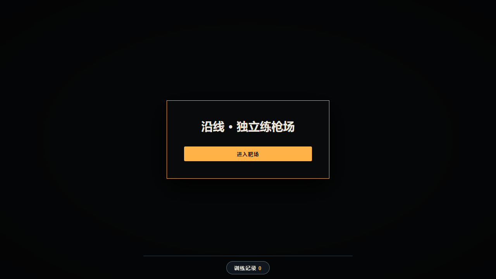
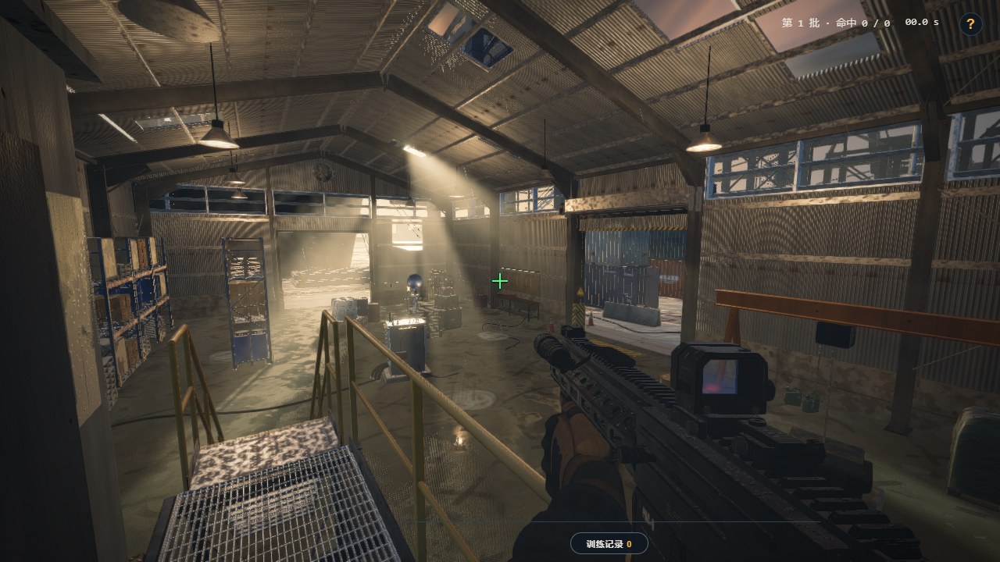
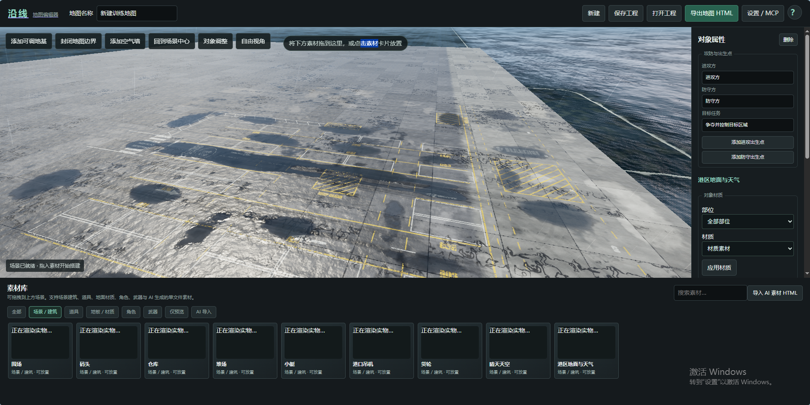

# 沿线练枪靶场

基于原有完整场景制作的 Windows 桌面练枪项目。玩家在仓库训练区练习瞄准，结合计时、训练统计和可选的 AI 分析，比较适合自己的窗口内灵敏度。





## 开始使用

1. 按下方步骤构建后，在 Windows 上运行 `练枪靶场/沿线练枪靶场.exe`，点击“进入靶场”。这个打包结果留在本机，不纳入仓库。需要 Microsoft Edge WebView2 运行时，无需另外安装 Python。
2. 加载后按 **P** 打开设置；点击“开始训练”，按提示校准或手动填写鼠标硬件 DPI。倒计时结束后出现靶子。
3. 使用鼠标瞄准和射击，W/A/S/D 移动；Tab 或右上角问号查看操作，Esc 显示退出确认。

支持随机固定靶与无人机移动靶、准星和窗口内灵敏度调整、训练记录与计时报告。AI 分析由用户在训练结束后选择，提供调整原因和下一轮建议；不启用 AI 也可正常训练。AI 服务地址和模型在 [backend.py](练枪靶场/backend.py) 中配置，默认使用局域网服务。有关 DPI 校准、权限和统计的详细说明见 [使用说明](练枪靶场/使用说明.md)。

灵敏度调整只作用于靶场窗口，不修改鼠标硬件 DPI 或 Windows 指针速度。DPI 可由用户填写或根据实际移动距离估算，结果需结合多轮训练比较。

## 项目结构与构建

- `index.html`：原始场景文件，保留原样。
- `练枪靶场/`：独立靶场网页、Python 本地服务和 Windows 桌面程序。
- `练枪靶场/src-tauri/`：Tauri 桌面端源码。

重新构建需要 Windows、Python 3（安装 PyInstaller）、Rust/MSVC 和 WebView2。在 `练枪靶场` 目录依次执行：

```powershell
python -m PyInstaller --noconfirm backend-service.spec
cargo build --release --manifest-path src-tauri/Cargo.toml
```

结果位于 `src-tauri/target/release/saltline-range.exe`。先构建本地服务组件，再构建 Tauri 程序；EXE 会内嵌该组件和网页资源。运行时使用 `127.0.0.1:8876`，窗口关闭时服务随之退出；如果端口被占用，需要先关闭占用它的程序。

## 后续扩展计划

- 1v1 对战单挑。
- 3v3 对战。
- 地图编辑器已可使用：空白搭建、对象材质、真实缩略图、MCP 素材与地图生成、独立 HTML 导出。

1v1 和 3v3 对战仍为规划内容。

运行 `npm run editor` 后访问 http://127.0.0.1:8765/ 。先在地图项目列表中新建、打开或删除工程，再进入编辑器；MCP 配置也在列表页独立完成。详细操作和 MCP 配置见 [地图编辑器使用说明](docs/设计方案/地图编辑器使用说明.md)；可直接打开 [晴日港区地图](地图/晴日港区集装箱争夺.html)。素材协议见 [AI 素材生成指导](docs/ai素材指南/AI素材生成指导.md)。



编辑器支持 Blender 风格的对象调整：对象模式下点击选择、拖动平移、滚轮缩放，`Ctrl+D` 复制，`Ctrl+Z`/`Ctrl+Y` 撤销与重做。自由视角只使用 `W/S` 前后移动，鼠标控制方向，`Esc` 退出。空气墙可从工具栏创建，选中后以线框尺寸面板调整。
